<!--
Which skin shows is set below. Switch from the terminal:
python3 scripts/use_skin.py space | frost | frost-day | frost-night | auto | swap
Redraw after your public repos change: python3 scripts/build_skins.py
-->
<!-- skin:start -->
<picture>
  <source media="(prefers-color-scheme: dark)" srcset="./skins/frost-night.svg">
  <source media="(prefers-color-scheme: light)" srcset="./skins/frost.svg">
  
</picture>
<!-- skin:end -->
