<!--
Which skin shows is set below. Switch from the terminal:
python3 scripts/use_skin.py space | frost | frost-day | frost-night | auto | swap
Redraw after your public repos change: python3 scripts/build_skins.py

The skins are redrawn every day by .github/workflows/skins.yml and published to the
"skins" branch (not to main). The profile is served from main, so the images below are
referenced by absolute URL on the skins branch -- a relative ./skins/ path would resolve
to main's stale copy and the profile would never auto-update.
-->
<!-- skin:start -->
<picture>
  <source media="(prefers-color-scheme: dark)" srcset="https://raw.githubusercontent.com/Aws-702/Aws-702/skins/frost-night.svg">
  <source media="(prefers-color-scheme: light)" srcset="https://raw.githubusercontent.com/Aws-702/Aws-702/skins/frost.svg">
  
</picture>
<!-- skin:end -->
